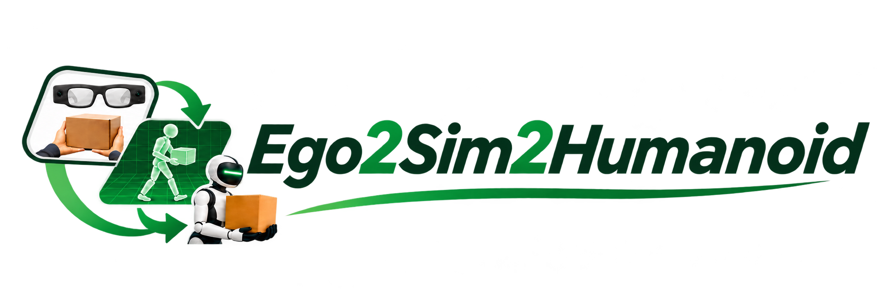

<p align="center">
  
</p>

# Ego2Sim2Humanoid: Agentic Real-to-Sim for Learning Loco-Manipulation VLAs without Robot Demonstrations

**Chen Liu and Nikolaus Correll**, University of Notre Dame

[[Paper (arXiv)]](https://arxiv.org/abs/2611.19196) [[Project page]](https://robonana.github.io/ego2sim2humanoid/)

## Code

The code is upcoming. This repository will host the Ego2Sim2Humanoid pipeline, which converts egocentric human recordings from smart glasses into physically verified training data for humanoid loco-manipulation policies. Watch or star this repository to be notified when it is released.

## Citation

```bibtex
@article{liu2026ego2sim2humanoid,
  title   = {Ego2Sim2Humanoid: Agentic Real-to-Sim for Learning Loco-Manipulation VLAs without Robot Demonstrations},
  author  = {Liu, Chen and Correll, Nikolaus},
  journal = {arXiv preprint arXiv:2611.19196},
  year    = {2026}
}
```
